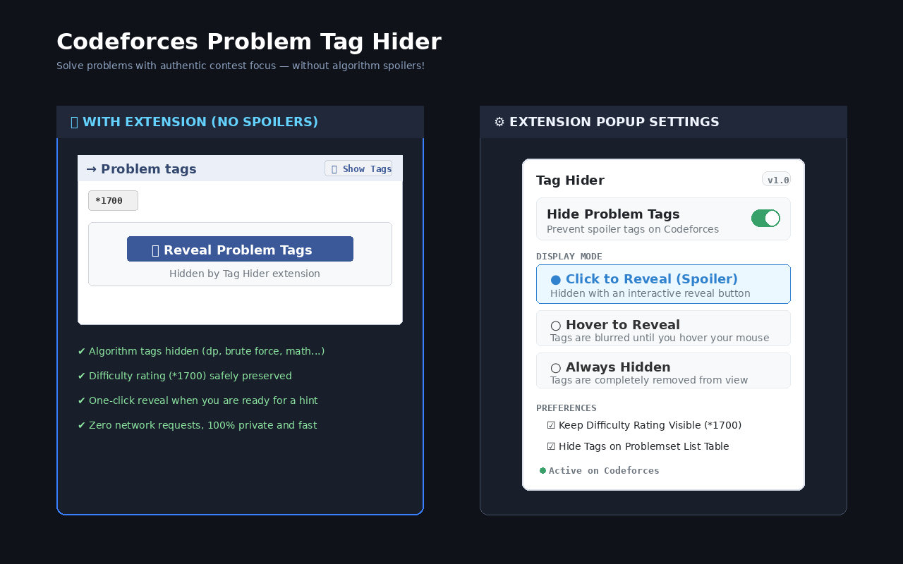

<div align="center">

# 🙈 Codeforces Problem Tag Hider

**Conceal spoiler problem tags (like `dp`, `brute force`, `math`, `greedy`) on Codeforces to train with authentic contest mindset.**

[](https://developer.chrome.com/docs/extensions/mv3/intro/)
[](https://opensource.org/licenses/MIT)
[](#-how-to-install)
[](https://github.com/princexj/EXTENSION-CF-TAG-HIDER-/pulls)

<br/>



</div>

---

## 🎯 Why This Extension?

When practicing on [Codeforces](https://codeforces.com), seeing tags like **`dp`**, **`brute force`**, or **`binary search`** gives away the entire underlying technique before you even begin analyzing the problem.

This extension hides topic tags automatically while keeping the challenge level (difficulty rating e.g. `*1700`) clearly visible. When you are stuck and need a hint, you can reveal tags with a single click or a quick hover!

---

## ✨ Features

- **⚡ Zero Spoiler Flash (No FOUC)**: Declarative CSS hides tags synchronously at page start before DOM rendering completes.
- **⭐ Keep Difficulty Rating Visible**: Keeps rating tags (e.g. `*1400`, `*1700`, `*2200`) visible while hiding algorithm categories.
- **🎛️ 3 Flexible Display Modes**:
  1. **Click to Reveal (Default)**: Replaces tags with an interactive `[ 👁️ Reveal Problem Tags ]` button.
  2. **Hover to Reveal**: Tags are blurred and smoothly unblur when hovered.
  3. **Always Hidden**: Tags are completely removed for total distraction-free solving.
- **🔘 In-Page Quick Toggle**: Injects an intuitive `[ 👁️ Show Tags ]` / `[ 🙈 Hide Tags ]` button directly into the sidebar header.
- **📋 Problemset Table Protection**: Blurs algorithm tags in the `/problemset` table rows to prevent accidental spoilers while browsing problems.
- **🎨 Dark & Light Mode**: Seamless styling for both default Codeforces and community dark themes.
- **🔒 100% Private & Offline**: No tracking, no analytics, no external servers.

---

## 🚀 How to Install

### Manual Installation (Brave / Chrome / Edge)

1. **Clone or download** this repository:
   ```bash
   git clone https://github.com/princexj/EXTENSION-CF-TAG-HIDER-.git
   ```
2. Open your Chromium-based browser and navigate to the Extensions page:
   - **Brave**: `brave://extensions`
   - **Chrome**: `chrome://extensions`
   - **Edge**: `edge://extensions`
3. Toggle on **Developer mode** (usually in the top-right corner).
4. Click **Load unpacked** (top-left).
5. Select the `codeforces-tag-hider` folder.
6. Done! Navigate to any [Codeforces problem](https://codeforces.com/problemset) to see it in action.

---

## 📦 Packaging for Chrome Web Store

To bundle the extension into a production-ready `.zip` archive for the Chrome Web Store Developer Dashboard:

```bash
./package.sh
```

This outputs a validated, clean archive in `dist/codeforces-tag-hider-v1.0.0.zip` ready for upload.

For a full step-by-step submission guide and pre-filled store descriptions, see [`store-assets/STORE_LISTING.md`](store-assets/STORE_LISTING.md).

---

## 🔒 Privacy & Permissions

We believe in maximum user privacy:
- **`storage`**: Used solely to persist your UI preferences (display mode, rating visibility) across browser sessions.
- **Host Permissions (`*.codeforces.com`, `*.codeforces.net`, `*.codeforc.es`)**: Required exclusively to inject the styling and toggle controls onto Codeforces pages.

For full details, read our [Privacy Policy](PRIVACY.md).

---

## 📄 License

Distributed under the **MIT License**. See [`LICENSE`](LICENSE) for more information.
